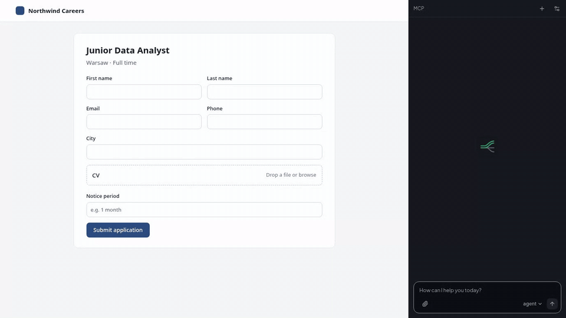
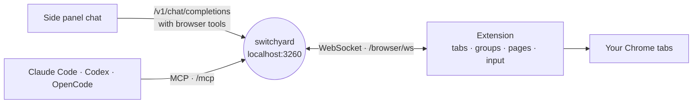

<div align="center">

<picture>
  <source media="(prefers-color-scheme: dark)" srcset="docs/images/logo-dark.png">
  
</picture>

Chrome extension for [Switchyard](https://github.com/kravchenski/switchyard). It gives the models behind Switchyard a side panel chat that can read pages, click, type and manage tabs, and gives Claude Code, Codex and OpenCode the same browser tools over MCP.

[](https://github.com/kravchenski/switchyard-extension/actions/workflows/ci.yml)
[](LICENSE)

[Install](#install) · [Side panel](#side-panel) · [Coding agents](#coding-agents-mcp) · [Tools](#tools) · [Safety](#safety) · [Development](#development)



Filling in a job application from a CV. [Watch as MP4](docs/images/demo.mp4)

</div>

## How it works



The panel sends your message to Switchyard with a set of browser tools, runs the tool calls the model returns and repeats until the model answers. Pages are read as an outline with element refs; clicks and typing go through `chrome.debugger` as real input events. Any model Switchyard lists can drive it, including `agent` and `auto`.

The same tools reach coding agents: the extension keeps a WebSocket to Switchyard, and Switchyard serves the tools over MCP.

While the agent works, its tab joins a green Switchyard tab group, and the page shows a frame, a status bar with Stop and the cursor moving to each click.

## Install

1. Start Switchyard (`bun run start` in the [switchyard](https://github.com/kravchenski/switchyard) repo, or the desktop app).
2. Build the extension:

   ```sh
   git clone https://github.com/kravchenski/switchyard-extension.git
   cd switchyard-extension
   bun install
   bun run build      # writes dist/
   ```

3. Open `chrome://extensions`, turn on **Developer mode**, choose **Load unpacked** and pick `dist/`.
4. Click the Switchyard icon in the toolbar to open the side panel.

The manifest `key` pins the extension id to `dammhajbcgfiiaokdhfchhncfaknaemj`, which Switchyard trusts on `localhost` (`EXTENSION_ORIGINS`), so no API key is needed. If Switchyard runs with `GATEWAY_API_KEY`, enter the same key in **Settings**; **Test connection** checks it. Chrome 116 or newer is required.

## Side panel

Ask in plain words: "group my GitHub tabs into a blue group called Code", "summarize this page", "fill in this form with my CV". Answers render as Markdown, and each tool call is a row you can expand.

Files can be attached with the paperclip, pasted, or dropped on the panel, up to 5 files of 10 MB each. Text files and images go to the model with your message. Other files, such as a PDF, are only named to the model; `upload_file` can put them into a file field on the page. The agent can also write files with `create_file` (a cover letter, a CSV); they show up in the chat with a Download button and are kept only for the conversation.

When the agent needs something only you know, it asks with `ask_user`. Click an option, press its number or type your own answer.

Skills are instructions the agent loads with `use_skill` when a task fits, the way Claude Code does. There is one so far, `resume`, for tailoring a resume or cover letter to a job posting and filling in application forms. It asks for missing facts rather than inventing them. Skills live in `src/skills/`.

The model picker in the composer switches between Switchyard's `agent`, `auto` and `vision` routing and the models it lists.

<div align="center">

</div>

## Coding agents (MCP)

The extension keeps a WebSocket open to Switchyard and sends it the tool list; Switchyard serves those tools over MCP at `/mcp`.

```sh
claude mcp add --transport http switchyard-browser http://127.0.0.1:3260/mcp
```

Or register the server for Claude Code, Codex and OpenCode at once from the switchyard repo:

```sh
bun run setup:agents -- --browser-tools
```

Calls from agents show up in the side panel chat marked as coming from a coding agent, and the page shows *"A coding agent is using this tab through Switchyard"*. `ask_user` is not offered over MCP; agents ask you in their own chat.

## Tools

| Group | Tool | What it does |
| --- | --- | --- |
| Tabs | `tabs_list` | List tabs (`all`, `window` or `session`) |
| | `tab_create` | Open a tab in the Switchyard group |
| | `tab_close` | Close tabs; asks first for tabs outside the Switchyard group |
| | `tab_activate` | Switch to a tab |
| | `navigate` | Open a URL, or go back, forward or reload |
| Groups | `group_list` | List tab groups |
| | `group_create` | Group tabs with a title and color |
| | `group_update` | Rename, recolor or collapse a group |
| | `tab_move_to_group` | Add tabs to a group |
| | `ungroup` | Remove tabs from their group |
| Page | `read_page` | Page outline with element refs (`ref_12`) for click and type |
| | `find` | Find visible elements by label, text or placeholder |
| | `get_page_text` | Visible text of the page |
| | `screenshot` | Capture the visible tab, sized to CSS pixels |
| Input | `click` | Click a ref or a viewport point |
| | `type` | Type into a ref or the focused element |
| | `key` | Press keys and shortcuts, e.g. `Control+a Delete` |
| | `scroll` | Scroll the page or the area under a ref |
| | `hover` | Move the mouse over a ref or point |
| | `wait` | Wait a number of milliseconds |
| Files | `create_file` | Make a file you can download and `upload_file` can use |
| | `upload_file` | Put a file into a file input, upload button or drop zone |
| Chat | `ask_user` | Ask you a question with options (side panel only) |
| | `use_skill` | Load a skill's instructions before a task it covers |

## Safety

- `click`, `type`, `key` and `upload_file` ask once per site per browser session. This can be turned off in Settings.
- Coding agents get the same prompt in the side panel when it is open. When it is closed, their call fails with a message for the agent, unless "Act on new sites without asking" is on.
- The agent is told to treat page text as data, never as instructions, and to ask before purchases, sending messages, deleting data or entering passwords and payment details.
- Attached and created files stay in the extension's memory for the conversation (created files up to 2 MB). Nothing is written to disk unless you click Download.
- Because input uses `chrome.debugger`, Chrome shows its "started debugging this browser" bar while the agent works. The debugger detaches after 30 seconds without input.

## Development

```sh
bun run dev        # rebuild dist/ on change
bun run ci         # typecheck, tests and build
```

| Path | What lives there |
| --- | --- |
| `src/background/` | Service worker: agent loop, Switchyard client, MCP bridge, session group, overlay presence |
| `src/tools/` | Browser tools and the registry that validates their arguments |
| `src/content/` | Functions injected into pages: page outline, overlay, file upload |
| `src/sidepanel/` | Chat UI and the Markdown renderer |
| `src/skills/` | Skills as Markdown, registered in `index.ts` |
| `static/` | Manifest, HTML, CSS, fonts and icons |

CI runs typecheck, tests and build on every push to `master` and on pull requests, and uploads `dist/` as an artifact. Release runs on a `v*` tag: it checks that the tag matches `package.json` and `static/manifest.json`, then attaches a zipped `dist/` to a GitHub release.

```sh
git tag v0.1.0 && git push origin v0.1.0
```

## License

[MIT](LICENSE)
