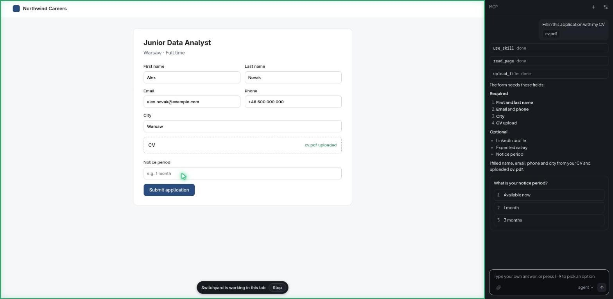
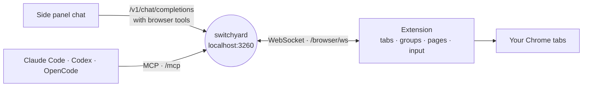
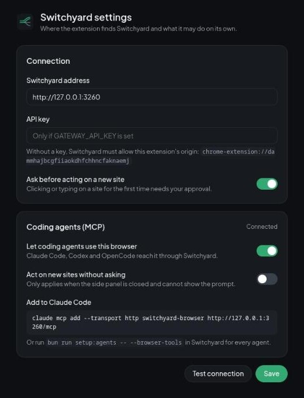

<div align="center">

<picture>
  <source media="(prefers-color-scheme: dark)" srcset="docs/images/logo-dark.png">
  
</picture>

**Browser extension for [Switchyard](https://github.com/kravchenski/switchyard).**<br>
A side panel agent that reads pages, clicks, types and manages your tabs with any model behind Switchyard, and the same browser tools for Claude Code, Codex and OpenCode over MCP.

[](https://github.com/kravchenski/switchyard-extension/actions/workflows/ci.yml)
[](https://developer.chrome.com/docs/extensions/develop/migrate/what-is-mv3)
[](https://bun.sh)
[](#coding-agents-mcp)
[](LICENSE)

[Install](#install) · [Side panel](#side-panel) · [Coding agents](#coding-agents-mcp) · [Tools](#tools) · [Safety](#safety) · [Development](#development)



*Filling in an application: the agent works in the page on the left and asks what only you know on the right.*

</div>

## How it works



- **Uses your browser as you do.** The agent reads the page as an outline with element refs, clicks and types with real mouse and keyboard events, takes screenshots, and opens, groups and closes tabs.
- **Shows what it is doing.** The tab it works in joins a green **Switchyard** tab group. A frame, a status bar with Stop and a gliding cursor mark every action on the page.
- **Any model behind Switchyard.** The panel talks to Switchyard's OpenAI-compatible API, so `agent`, `auto` or any listed model can drive it, including free APIs and signed-in web chats.
- **One set of tools for coding agents.** Switchyard serves the same tools over MCP, so Claude Code, Codex and OpenCode can test a page, fill a form or read docs in your real browser.
- **Asks instead of guessing.** Questions come as cards with options you answer with a click or a number key, and acting on a new site needs your approval.

## Install

1. Start Switchyard (`bun run start` in the [switchyard](https://github.com/kravchenski/switchyard) repo, or the desktop app).
2. Build the extension:

   ```sh
   git clone https://github.com/kravchenski/switchyard-extension.git
   cd switchyard-extension
   bun install
   bun run build      # writes dist/
   ```

3. Open `chrome://extensions`, turn on **Developer mode**, choose **Load unpacked** and pick `dist/`.
4. Click the Switchyard icon in the toolbar to open the side panel.

The manifest `key` pins the extension id to `dammhajbcgfiiaokdhfchhncfaknaemj`, which Switchyard trusts on `localhost` (`EXTENSION_ORIGINS`), so no API key is needed. If Switchyard runs with `GATEWAY_API_KEY`, enter the same key in **Settings**; **Test connection** checks it. Chrome 116 or newer is required.

## Side panel

Type what you want done: *"group my GitHub tabs into a blue group called Code"*, *"summarize this page"*, *"fill in this form with my CV"*. The agent sends your message with the browser tools to Switchyard, runs the tool calls the model returns and loops until it has an answer.

- **Answers in Markdown.** Lists, tables, code and links render in the chat; tool calls show as compact rows you can expand.
- **Attach files** with the paperclip, by pasting or by dropping them on the panel (up to 5 files, 10 MB each). Text files and images go to the model with your message. Other files, such as a PDF CV, are listed for `upload_file`, which puts them into a file field on the page.
- **Files the agent makes.** `create_file` writes a cover letter, a CSV or notes. They appear in the chat with **Download** and stay in memory for the conversation only.
- **Questions with options.** When the agent needs something only you know, `ask_user` shows a card: click an option, press its number, or type your own answer.
- **Skills.** Like Claude Code skills, the agent loads step-by-step instructions with `use_skill` when a task matches. The `resume` skill tailors a resume or cover letter to a job posting so it passes ATS and recruiter screening, and fills application forms. It asks for missing facts instead of inventing them. Add your own in `src/skills/`.
- **Model picker.** Switch between Switchyard's `agent`, `auto` and `vision` routing or any model it lists.

<div align="center">

</div>

## Coding agents (MCP)

The extension keeps a WebSocket open to Switchyard and sends it the tool list; Switchyard serves those tools over MCP at `/mcp`.

```sh
claude mcp add --transport http switchyard-browser http://127.0.0.1:3260/mcp
```

Or register the server for Claude Code, Codex and OpenCode at once from the switchyard repo:

```sh
bun run setup:agents -- --browser-tools
```

Calls from agents show up in the side panel chat marked as coming from a coding agent, and the page shows *"A coding agent is using this tab through Switchyard"*. `ask_user` is not offered over MCP; agents ask you in their own chat.

## Tools

| Group | Tool | What it does |
| --- | --- | --- |
| Tabs | `tabs_list` | List tabs (`all`, `window` or `session`) |
| | `tab_create` | Open a tab in the Switchyard group |
| | `tab_close` | Close tabs; asks first for tabs outside the Switchyard group |
| | `tab_activate` | Switch to a tab |
| | `navigate` | Open a URL, or go back, forward or reload |
| Groups | `group_list` | List tab groups |
| | `group_create` | Group tabs with a title and color |
| | `group_update` | Rename, recolor or collapse a group |
| | `tab_move_to_group` | Add tabs to a group |
| | `ungroup` | Remove tabs from their group |
| Page | `read_page` | Page outline with element refs (`ref_12`) for click and type |
| | `find` | Find visible elements by label, text or placeholder |
| | `get_page_text` | Visible text of the page |
| | `screenshot` | Capture the visible tab, sized to CSS pixels |
| Input | `click` | Click a ref or a viewport point |
| | `type` | Type into a ref or the focused element |
| | `key` | Press keys and shortcuts, e.g. `Control+a Delete` |
| | `scroll` | Scroll the page or the area under a ref |
| | `hover` | Move the mouse over a ref or point |
| | `wait` | Wait a number of milliseconds |
| Files | `create_file` | Make a file you can download and `upload_file` can use |
| | `upload_file` | Put a file into a file input, upload button or drop zone |
| Chat | `ask_user` | Ask you a question with options (side panel only) |
| | `use_skill` | Load a skill's instructions before a task it covers |

## Safety

- **Approval per site.** `click`, `type`, `key` and `upload_file` ask once per site per browser session before acting. You can turn this off in **Settings**.
- **Coding agents ask too.** Their actions on a new site go through the side panel when it is open; otherwise the call fails with a message for the agent, unless **Act on new sites without asking** is on.
- **Page text is data.** The agent is told never to follow instructions found in a page and to ask before purchases, sending messages, deleting data or entering passwords and payment details.
- **Files stay in memory.** Attached and created files live in the extension for the conversation, up to 2 MB per created file. Nothing reaches your disk unless you click **Download**.
- **Visible debugging.** Input uses `chrome.debugger`, so Chrome shows its "started debugging this browser" bar while the agent works. It detaches after 30 seconds without input.

## Development

```sh
bun run dev        # rebuild dist/ on change
bun run ci         # typecheck, tests and build
```

| Path | What lives there |
| --- | --- |
| `src/background/` | Service worker: agent loop, Switchyard client, MCP bridge, session group, overlay presence |
| `src/tools/` | Browser tools and the registry that validates their arguments |
| `src/content/` | Functions injected into pages: page outline, overlay, file upload |
| `src/sidepanel/` | Chat UI and the Markdown renderer |
| `src/skills/` | Skills as Markdown, registered in `index.ts` |
| `static/` | Manifest, HTML, CSS, fonts and icons |

**CI** runs typecheck, tests and build on every push to `master` and on pull requests, and uploads `dist/` as an artifact. **Release** runs on a `v*` tag: it checks that the tag matches `package.json` and `static/manifest.json`, then attaches a zipped `dist/` to a GitHub release.

```sh
git tag v0.1.0 && git push origin v0.1.0
```

## License

[MIT](LICENSE)
